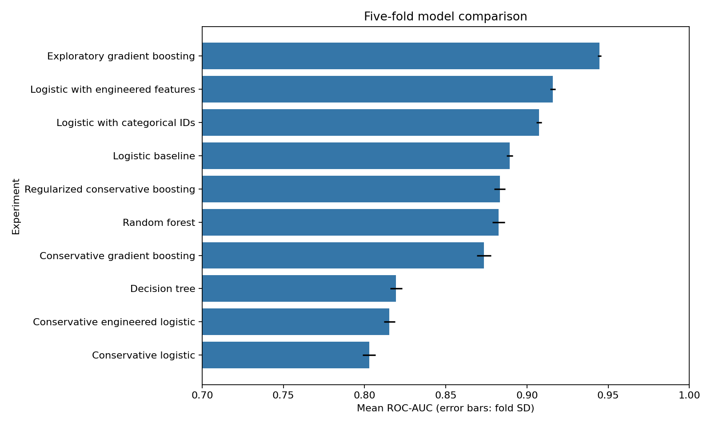

# Hotel Cancellation Prediction
**Suffolk University · ISOM 835 · Fall 2026**

**Anshuman Agrawal · Mark Belov · Phuc Hoang · Sarah Legault**
Team: **Ctrl_+_Alt_+_Defeat**

Predict cancellation probabilities for hotel bookings using a reproducible, fold-fitted machine learning workflow.

[](https://colab.research.google.com/github/agrawalanshuman/Hotel_Cancellation_Prediction_Model/blob/main/notebooks/Hotel_Cancellation_Analysis.ipynb)

Start with **[Hotel Cancellation Analysis](notebooks/Hotel_Cancellation_Analysis.ipynb)**. One notebook contains setup, data validation, exploration, leakage review, feature engineering, ten experiments, model comparison, calibration, secondary validation and draft submission generation. Run cells in order. Colab asks for the three authorized competition CSVs; no repository ZIP or src folder is needed.

| File or folder | What it contains |
|---|---|
| `notebooks/Hotel_Cancellation_Analysis.ipynb` | Complete project with numbered sections and measured outputs |
| `hotel_cancellation_analysis.py` | The same executable analysis as one optional Python script |
| `experiments/` | Readable experiment names, fold scores, feature ablations and timing decisions |
| `results/` | Model comparison, data/submission checks, summary and robustness results |
| `results/figures/` | Exploration, model-comparison and calibration figures |
| `classwork/` | Only submission materials: draft modeling memo and presentation; locally generated draft prediction CSV |
| `data/` | Private train.csv, test.csv and sample_submission.csv (local only) |

## Results
All scores below are **measured five-fold stratified ROC-AUC**, seed 835. They are not Kaggle leaderboard scores.

| Model | Mean AUC |
|---|---:|
| Logistic baseline | 0.88936 |
| Logistic with categorical IDs | 0.90740 |
| Logistic with engineered features | 0.91597 |
| Exploratory gradient boosting | 0.94471 |
| Regularized conservative boosting | 0.88323 |

Correct categorical handling improved the logistic baseline by 0.01804 AUC. The exploratory model retains uncertain fields. The conservative candidate excludes seven questioned fields, but remaining booking-time availability still needs review. Secondary conservative validation was lower: held-out-agent AUC 0.80541 and estimated-booking-time AUC 0.77825. No model is certified leak-free or approved for final submission yet.



[View all figures](results/figures/) · [Full results](results/model_summary.md) · [Experiment history](experiments/experiment_log.csv)

## Run locally
```bash
python -m pip install -r requirements.txt
# Place only authorized competition CSVs in data/.
python -m jupyterlab notebooks/Hotel_Cancellation_Analysis.ipynb
# Or run the same workflow as a script:
python hotel_cancellation_analysis.py
```

Data checks require 83,573 training rows and 35,817 test rows. The submission check verifies id,is_canceled columns, unique complete test IDs in sample order, and finite continuous probabilities between 0 and 1. Competition data and row-level prediction CSVs are kept private and excluded from Git. No external datasets are used.

AI assistance: **ChatGPT and OpenAI coding tools** supported coding and debugging
